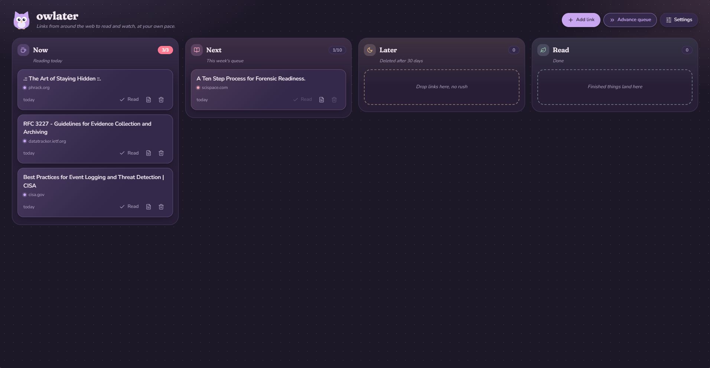

# owlater

I save a lot of links "for later" and almost never come back to them. This is a small browser extension that keeps my saved links (articles, videos, whatever) on a board, and nudges me to actually get through them.

You click the owl on any page, add a quick note if you want, and pick where it goes. Then the board shows everything in four columns:

- **Now**: what you're reading or watching today. Capped at 3, on purpose.
- **Next**: this week's queue, capped at 10.
- **Later**: the pile. No rush, but it can start to expire (see below).
- **Read**: done.

Cards drag between columns. Each one can have a note, like why you saved it.

## Making yourself finish things

None of this is on by default, it's all in Settings:

- **Advance queue** pulls the oldest cards up a column until the one above is full. It can also run by itself once a day.
- **Daily reminder** sends a notification at a time you pick.
- **Auto-delete** removes cards that have sat in Later for N days. With it off they just turn red. With it on they are deleted forever.
- **Commitment mode** only lets you delete or mark as read the cards that are in Now. Handy if you tend to clear things out instead of reading them.

There are a few color themes too, and export/import for backups (a plain JSON file).

Everything is stored locally in the browser. There's no account and no server (but this means there's no sync as well, *yet*).

## Installing it

It isn't on the Chrome Web Store yet, so you have to install it manually:

1. Download or clone this repo.
2. Open `chrome://extensions` and turn on Developer mode.
3. Click "Load unpacked" and choose the `src` folder.

It should work in other Chromium browsers (Edge, Brave, Helium and so on) the same way, though I've only used it in Helium.

## Credits

Icons by [Lucide](https://lucide.dev), licensed under the ISC License.

Fonts [Fraunces](https://fonts.google.com/specimen/Fraunces) and [Nunito](https://fonts.google.com/specimen/Nunito), licensed under the SIL Open Font License 1.1.

The code is under the MIT License, see `LICENSE`.
